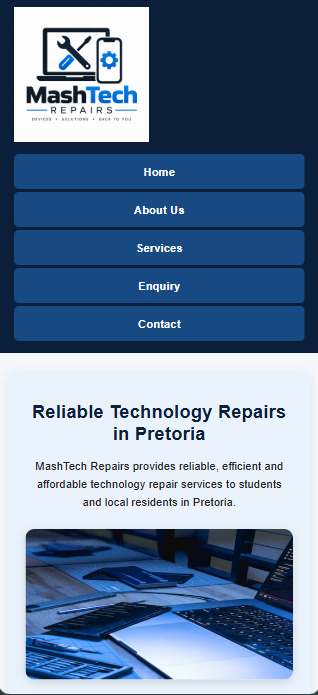

# MashTech Repairs

## WEDE5020 – Web Development (Introduction)

### Portfolio of Evidence – Part 1

**Website:** MashTech Repairs
**Purpose:** Technology Repair Services Website
**Location:** Pretoria, Gauteng, South Africa

---

## 1. Project Overview

MashTech Repairs is a technology repair business website developed for the WEDE5020 Web Development (Introduction) Portfolio of Evidence.

The website provides information about the business, its technology repair services and how customers can contact the business or submit a repair enquiry.

The website was developed using HTML and follows a simple multi-page website structure.

The main purpose of the website is to provide customers with clear information about MashTech Repairs and make it easy for them to navigate between the available services, business information, contact details and enquiry form.

---

## 2. Website Objectives

The objectives of the MashTech Repairs website are to:

* Provide information about MashTech Repairs.
* Explain the technology repair services offered.
* Allow customers to submit a repair enquiry.
* Provide customers with contact information.
* Provide information about the business and its values.
* Provide clear navigation between the different website pages.
* Create a simple and accessible structure for users looking for technology repair services.

---

## 3. Website Pages

The website consists of the following pages:

### Home Page – `index.html`

The homepage introduces MashTech Repairs and provides an overview of the business.

It includes:

* A website heading.
* Navigation links.
* An introduction to MashTech Repairs.
* A list of the main services.
* Reasons to choose the business.
* Links to the services and enquiry pages.
* Footer information.

### About Us – `about.html`

The About Us page provides information about MashTech Repairs.

It includes:

* Background information.
* The business vision.
* Business values.
* The customers the business serves.
* A link to submit an enquiry.

### Services – `services.html`

The Services page explains the technology repair services offered by MashTech Repairs.

The services covered include:

* Smartphone repairs.
* Laptop repairs.
* Tablet repairs.

The page also provides a link to the enquiry form.

### Enquiry – `enquiry.html`

The Enquiry page contains the repair enquiry form.

The form collects:

* Customer full name.
* Email address.
* Phone number.
* Device type.
* Device brand.
* Repair type.
* Description of the device problem.
* Preferred contact method.

The form also includes Submit Enquiry and Clear Form buttons.

### Contact – `contact.html`

The Contact page provides ways for customers to communicate with MashTech Repairs.

It includes:

* Telephone contact information.
* Email address.
* Business hours.
* Pretoria Central information.
* Hatfield information.
* A link to the online enquiry form.

---

## 4. Technologies Used

The following technologies were used to develop Part 1:

* HTML5
* Visual Studio Code
* Git/GitHub

HTML5 was used to create the structure and content of the website.

Visual Studio Code was used as the development environment.

GitHub is used to store and manage the website project.

---

## 5. HTML Features Used

The website uses a variety of HTML elements to structure the content, including:

* `header`
* `nav`
* `main`
* `section`
* `article`
* `footer`
* Headings
* Paragraphs
* Lists
* Links
* Forms
* Labels
* Input fields
* Select menus
* Textareas
* Buttons
* Fieldsets
* Legends

Semantic elements such as `header`, `nav`, `main`, `section`, `article` and `footer` were used to give the website a clear structure.

---

## 6. Navigation

A navigation menu is included on the website pages.

The navigation allows users to move between:

* Home
* About Us
* Services
* Enquiry
* Contact

Internal links are used to connect the HTML pages.

The enquiry and contact sections also contain links that direct users to the enquiry form.

---

## 7. Enquiry Form

The website includes an HTML enquiry form designed to collect information about a customer's repair request.

The form uses different input types and controls appropriate to the information being collected.

These include:

* Text input.
* Email input.
* Telephone input.
* Select/drop-down menus.
* Radio buttons.
* Textarea.
* Submit button.
* Reset button.

Required fields are marked using the HTML `required` attribute.

The form uses:

<form action="#" method="post">

The form structure is divided into fieldsets to organise the information into logical groups.

---

## 8. Project Structure

The Part 1 project uses the following structure:

MashTech Repairs/
│
├── index.html
├── about.html
├── services.html
├── enquiry.html
├── contact.html
│
├── _images/
│   └── page/
│       └── uU3BgbtcUcciF6dyVWNfEc-1920-80.jpg
│
├── css_assets/
│   ├── homepage.css
│   └── subpages.css
│
├── js_assets/
│   ├── homepage.js
│   └── subpages.js
│
├── .vscode/
│   └── launch.json
│
└── README.md

The CSS and JavaScript asset folders were established as part of the project structure and are used as the foundation for the continued development of the website in later parts of the PoE.

---

## 9. Part 1 Result

The completed Part 1 submission received a mark of:

**78%**

The mark indicates that the Part 1 submission met a substantial portion of the assessment requirements.

The website is being continued and improved in Part 2 based on the requirements of the next stage of the WEDE5020 Portfolio of Evidence.

---

## 10. Development Environment

The website was developed using:

**Visual Studio Code**

The project can be opened as a folder in Visual Studio Code and the HTML pages can be viewed in a web browser.

During development, the website can be run using a local development environment such as Live Server.

---

## 11. References

The following resources may be used as supporting web-development references:

* Mozilla Developer Network (MDN). (n.d.). *HTML: HyperText Markup Language*. Available at: https://developer.mozilla.org/en-US/docs/Web/HTML

* W3Schools. (n.d.). *HTML Tutorial*. Available at: https://www.w3schools.com/html/

* The Independent Institute of Education (IIE). *WEDE5020 Web Development (Introduction) prescribed module/textbook material*.

* Unsplash. (n.d.). *Unsplash*. Available at: https://unsplash.com/

## Part 2 – CSS Styling and Responsive Design

Part 2 builds on the website developed in Part 1 by adding external CSS styling and responsive design.

The website has been improved using CSS for desktop presentation, typography, layout, colours, decoration and interactive states. Responsive styling has also been added so that the website adapts to tablet and mobile screen sizes.

### CSS Structure

The project uses external CSS stylesheets:

- `css_assets/homepage.css` – styling for the homepage.
- `css_assets/subpages.css` – styling for the website subpages.

The CSS includes:

- Default/base styling
- Typography styling
- Flexbox and/or Grid layout
- Colours and decorative styling
- Hover, focus and active states
- Responsive media queries
- Responsive image styling

### Responsive Design

Responsive breakpoints have been implemented for desktop, tablet and mobile screen sizes.

The layout, typography, navigation and images are adjusted at smaller screen sizes to maintain usability and readability.

### Responsive Images

Responsive image techniques have been incorporated using:

- `<picture>`
- `srcset`
- `sizes`
- Different image resolutions

This allows images to adapt to different screen sizes.

### Testing

The website will be tested using browser developer tools at desktop, tablet and mobile viewport sizes.

Planned test sizes include:

- Desktop: 1920 × 1080
- Tablet: 768 × 1024
- Mobile: 390 × 844

## Changelog

### Part 2 Development

- Created external CSS stylesheets for the website.
- Linked the external stylesheets to the relevant HTML pages.
- Added default CSS styling for the website.
- Added typography styling for headings, paragraphs, links and other text elements.
- Added layout styling using CSS layout techniques.
- Added colours, borders, spacing and other decorative styling.
- Added hover, focus and active pseudo-classes to interactive elements.
- Added responsive breakpoints for tablet and mobile screen sizes.
- Adjusted page layouts for smaller screens.
- Adjusted typography for smaller screen sizes.
- Adjusted the navigation for smaller screen sizes.
- Added responsive styling for website images.
- Added responsive images using the `picture`, `srcset` and `sizes` techniques.
- Added and integrated the MashTech Repairs logo throughout the website.
- Added technology-related imagery to improve the visual presentation of the website.
- Updated the README with Part 2 development information and references.

### Part 1 Feedback

Part 1 feedback has not yet been received. This section will be updated once the lecturer releases the Part 1 marks and feedback, and any required corrections will be recorded here.

## References

### Web Development Resources

- Mozilla Developer Network (MDN). (n.d.). CSS: Cascading Style Sheets. Available at: https://developer.mozilla.org/en-US/docs/Web/CSS

- W3Schools. (n.d.). CSS Tutorial. Available at: https://www.w3schools.com/css/

### Images

- Unsplash. (n.d.). Laptop, smartphone and repair tools on a desk. Available at: https://unsplash.com/

- Unsplash. (n.d.). Laptop beside smartphone. Available at: https://unsplash.com/

- Unsplash. (n.d.). Computer repair imagery. Available at: https://unsplash.com/

- Unsplash. (n.d.). Laptop and smartphone workspace. Available at: https://unsplash.com/

## Responsive Design Evidence

The website was tested using browser developer tools at different viewport sizes.

### Desktop

Tested at 1920 × 1080.

### Tablet

Tested at 768 × 1024.

### Mobile

Tested at 390 × 844.

